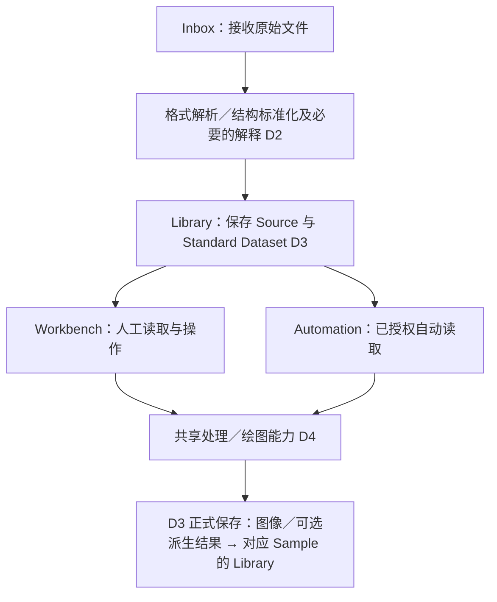

# SpinLab D5 — 自动处理与出图、前台自动化及 Spin Cat 决策稿

**版本**：v0.2（按 2026-11-08 用户澄清修订；产品/架构设计稿，非实施规范）  
**日期**：2026-11-08  
**状态**：记录已确认的产品约束，并明确 D5 的建议与 D6 待协调事项。未修改代码、正式规则、实验数据、Library 或 PR；未运行程序、分析或测试。  
**依据**：SpinLab 总体架构 V2；D1 v0.3、D2 v0.1、D3 v0.1、D4 v0.1；原 D5 v0.1；本次用户对 D5 目标及线性数据流的逐轮澄清。上游静态仓库审计基线为 `Jiaze-Li/SpinLab` `main` @ `86cd5c6ea707bf882fc415a4e8f4d1f1af2425af`，**并非本稿重新验证的最新仓库状态**。

> **本次修订的决定性变化**：D5 第一阶段的目标是可靠的**标准数据驱动的常规处理、自动出图和归档**，不是自动科研推理、综合报告或复杂多分析编排。所有正常 Workbench 操作与自动化都从 **Library 已保存的标准数据**取输入；统一器负责格式解析和结构表达，不修改测量内容；Library 是仓库，不是解析或计算引擎。

---

## 0. 一页结论

### 0.1 主数据流（本轮用户明确确认的全局目标原则）

**注意**：这个图是**数据与职责流**，不是物理存储必须如何分层，也不是自动运行的线程或队列实现图。Library 存在于输入和输出两端，但不会自己做标准化、科研处理或调度。前台工作流是线性的；从 Library 读取后可以有人工/自动两种操作方式，调用相同能力。

### 0.2 四条必须同时成立的产品原则

1. **统一器只做格式/结构的标准化**：解析不同仪器文件，保留原始数值、顺序、正负号、单位、通道、测量段和来源，整理为有共同读取契约的标准数据。**不做平滑、背景扣除、flatten、拟合、剔点、重采样或提取 Hc 等数据内容操作。**有依据的元数据解释可以附着在数据上；未知保持未知。关于单位数值转换的既有 D2 说法与本轮“不动测量内容”的更严格边界存在待协调处，见 §2.2、§10。
2. **Library 仅管理资产及关系**：保存原始来源、标准数据、图与可选计算成果；负责身份、归属、检索、版本与清理的治理接口。Library 不读取仪器格式、不替用户解释通道、不执行数据处理。
3. **Workbench 和 Automation 只消费 Library 标准数据**：正常分析/出图不可各自读取和解析原始 DAT/LVM/IBW；人工与自动使用同一份数据、同一处理能力及明确配置。Workbench 可为诊断跳转到 Inbox 看源文件证据，但不形成第二条生产科研处理路径。
4. **自动化第一阶段是常规工作自动执行**：按每种 Workflow 的生效默认处理/绘图参数，对新就绪的、匹配的标准数据运行，并把图存入对应 Sample 的 Library。可选输出轻量指标；不默认生成报告，不要求 AI 思考，不固定 RHEED/AFM/AHE 的串行关系。

### 0.3 哪些仍是未来能力

- RHEED **未来会加入**，但第一阶段目标是读标准数据、按预设流程处理/出图/保存；没有已确认的 RHEED 文件格式、解析器与绘图合同，不能假装已可执行。
- AHE 可按明确配置选择已有的背景处理、出图或 Hc、R_AHE 提取。**数值提取仍属于 D4 派生计算**，只是自动化不做额外科研判断；“暂时不做分析”不能被解释为允许 D2 偷做数值计算。
- 跨 Workflow 综合报告、自动科学推理、复杂分析依赖及经验模型训练均**非首阶段要求**；原 V2 的扩展边界可以保留，不得成为当前出图必须先建的重型体系。

---

## 1. 明确职责与控制权

| 角色 / 层 | 在首阶段负责 | 明确不负责 |
|---|---|---|
| **Inbox** | 接收/预览原始文件、展示接入状态和需要人工确认的问题；触发接入流程 | 拥有一份独立的计算/出图默认值；凭文件到达立即绕过标准数据做图 |
| **D2 解析与解释** | 按来源格式读全字段、保留来源内容，做结构性拆分与映射；记录真实通道/条件/解释与未知项；形成 Standard Dataset 的内容及来源关系 | 改测量内容、滤波、flatten、背景处理、拟合、推导指标；擅自推测 Rxx/Rxy/谐波角色 |
| **D3 / Library** | 按 Sample/Device/Measurement 及 Source/Standard Dataset ID 保存与提供数据；管理正式图、Result、引用、采用/删除/恢复 | 解析原始格式、解释物理含义、执行 D4 计算、决定 D5 何时运行 |
| **D4 共享处理与绘图** | 从 Library 标准数据按明确配置执行 AFM flatten、AHE 背景处理、图像渲染及可选指标提取；输出图与可能的派生数值/矩阵/曲线 | 以 Workbench Store 为唯一入口；隐式读取原始文件；决定正式采用/擅自保存 |
| **Workbench** | 人工从 Library 选数据、配置处理/绘图、预览、比较及触发保存；为本 Workflow 编辑默认预设和自动开关 | 重复实现源文件解析、保存第二份数据权威、承载自动执行器 |
| **D5 Automation** | 保管生效的触发/目标/预设/启停/授权，调用 D4，共享 D3 正式保存入口；记录必要运行状态 | 自创科研算法、对原始文件计算、私有保存、未授权修改 Parameter |
| **Spin Cat** | 后期提出格式规则、出图预设、流程或新能力的候选；提供变化与验证依据 | 自己发布正式流程/规则，或在后台积累不可见的执行权 |

**Workbench 是工作平台，不是数据源，也不是执行器。** 自动出图开关可以放在对应 AFM/AHE Workbench，但它控制的是独立的生效自动化定义，不能只是保存在某页面的开关状态。

## 2. “格式标准化”与“处理数据内容”划清边界

### 2.1 已确认：数据内容在接入阶段不被加工

这里的**标准化**指让不同仪器格式能被统一读取，而不是让它们的科研测量值经过“标准算法”变得更漂亮、更平滑或更适合分析。

- 可以做：读取 DAT、LVM、IBW 等格式；忠实组织列、矩阵、原始坐标、原始单位和标识；记录通道、扫描段与对象归属；为独立信号形成有来源关系的可读取资产。源数据的完整性、数值顺序、缺失状态、正负号、分支等必须保留。
- **不可以做**：丢掉看似无效的点、擅自去噪、插值、裁剪、对齐、背景扣除、改变曲线物理数值、AFM flatten、Hc 提取或图像美化；也不能把未知列填成 0 或随意转成另一个物理角色。
- 结构拆分本身不是测量算法，但必须有明确的源行段/信号定位与关联，不能因为拆成文件就丢失本来可以核验的内容。D3 已确认标准数据可按 Sample/测试段/独立科研信号物化；具体映射须与本边界共同验证。

### 2.2 解释元数据与数值转换：需要 D2/D6 对齐

D2 v0.1 已确认**有依据的 Channel/Role/单位/条件解释**与原始来源分开，以及未知不伪造；这些属于“描述数据是什么”，**并不必然意味着改数据值**。本轮原则不否定有证据的元数据解释。

但 D2 文稿还使用“单位规范转换”等措辞。为避免新的“格式标准化”悄悄改掉测量数值，**D5 建议**：标准数据默认保留原测量值与原单位；规范单位可以作为明确、可追溯的读取视图或 D4 调用时的显式转换；不得不留原值就直接改写。究竟何种**严格可逆/无损表达转换**可算作格式层操作，由 D2/D3/D6 收敛。**本条为建议，不冒充用户已逐项批准的单位转换政策。**

### 2.3 下游常规处理可以改“派生数据”，但不改输入标准数据

AFM Flatten、AHE 背景扣除即使是程序化日常操作，也会改变派生曲线/矩阵，因此只能在共享处理能力中发生。**读取标准数据是只读；正式保存的处理图/可选派生数值是新成果**，而不是修改或覆盖标准数据本身。对出图使用的 ROI、平滑、窗口、处理顺序、来源通道等，如果影响显示的数值内容，均需固化在出图配置中；纯视觉项如字体/颜色可单独管理。

## 3. 用户在前台如何使用

### 3.1 每个 Workflow 的最低操作面

以 AFM 或 AHE 为例，在对应 Workbench 内设置：

- **默认处理参数**：如 AFM 的 plane/line flatten 与 channel 选择，或 AHE 的背景处理窗口及是否提取 Hc；选项须是现有 D4 真实能力支持的配置。
- **默认出图参数**：坐标显示、颜色、图例、热图色标等；影响科研数值的设置与只影响图像外观的设置分开。
- **自动处理开关**：启用/停用、显示当前生效预设、适用哪些新标准数据、是否允许按配置自动存图。
- **试运行与最近结果**：用选中的已有标准数据预览出图和保存目标；显示最近一次执行状态、失败原因、能否明确重跑。

用户可正常人工使用 Workbench，手动探索参数并出图；**只有明确“保存为默认预设/应用自动化修改”**才会影响后续自动运行。临时拖动控件不会悄悄改生效默认值。

### 3.2 独立自动化对象仍有必要，但 UI 可以很轻

V2 已确认用户应该能从前台新建、修改、启停、试运行流程，不必改后台代码。**首阶段建议优先交付每个 Workflow 自带的自动开关和预设编辑**，再提供统一的自动化总览（可从各 Workflow 跳入）。同一个生效对象可以有多个入口，不能出现“Workbench 开关”和“自动化总览开关”各自拥有一份事实。

不需要节点画布或复杂跨 Workflow 依赖。非内置流程若仅由现有的“标准数据→处理/绘图→存图”能力组合而成，产品架构应允许前台创建；**是否首阶段交付任意组合式编辑器是范围建议，待 D6/产品排期确认**，不应错误写成已被取消的长期要求。

## 4. 自动运行从“标准数据就绪”开始

### 4.1 正确的触发链

**新原始文件进入 Inbox → D2 解析与必要解释 → D3 正式存好 Standard Dataset → D5 判断是否匹配、是否启用、是否具备输入 → D4 依生效默认配置处理/绘图 → D3 归档图和可选结果。**

关键差别：Inbox 接收是**接入事件**，而自动出图检查点是**正式标准数据已可读取**。不能以原始文件刚被拖入 Inbox 就绕过 D2/D3 调起 AFM/AHE 解析器。正式标准数据可按需带未知元数据；只有某个出图/提取能力真正依赖的角色未知，才阻塞那项动作。

### 4.2 一个文件不是一个唯一处理单位

同一 DAT 可以包含多个 Sample、Channel 与温度段；同一 Source 可能产出多份 Standard Dataset。自动化作用范围应以**具体标准数据、Sample/Device、通道/Role、测试段/条件**匹配；不能按原始文件名单键运行，也不能把同一来源的三条物理信号错误合并。若来源尚不能确定 Sample，标准数据可依规则暂存/待归属，但**自动写入对应 Sample Library**必须等归属清楚。

### 4.3 不制造自动化回环

D4 生成或 D3 保存的新图不是新原始测量，也不默认触发此出图流程。相同标准数据、同配置版本、同出图目的因重复事件/重试造成的等价产物应复用或按明确策略更新，**不无限追加**。不同真正测量即便数值一样也不可误去重。用户明确删除了某张图后，系统不能因为刷新或重复事件无声再生；确需补跑应有清晰的人工操作和恢复语义。

## 5. 自动化定义、运行、配置与正式成果的生效关系

| 概念对象 | 保存的信息 | 权威和角色 |
|---|---|---|
| **Standard Dataset** | 独立身份、具体测量值/结构、来源和原条件、已知解释/版本、Sample/Device/信号归属 | D2 负责生成内容，D3 负责正式保管；**是唯一正常处理输入** |
| **Workflow Preset** | 某 Workflow 的处理参数及出图参数、默认选择依据和版本 | 用户前台保存/应用；被人工或自动引用 |
| **Automation Definition / Activation** | 自动开关、触发（正式标准数据就绪）、匹配范围、引用哪个 Preset/能力版本、输出目标和授权、当前生效修订 | D5 的独立、可审阅正式对象；Workbench 仅是操作入口 |
| **Run / Step Outcome** | 来源事件、实际消费的 Standard Dataset ID、Sample/Device/段、数据解释、所用预设与共享能力/方法版本、状态、输出引用及正式提交结果 | D5 的一次执行记录；不是 Sample 或 Result 的新权威 |
| **Processed Output / Plot Artifact** | 图像及画图配置、所消费的标准数据版本、实际科学处理版本和必要诊断；有科研意义的派生数值/矩阵另保留适当类型 | D4 生成，D3 通过统一正式提交口保存；图片不是原始测量 |
| **Parameter / Adoption** | 某对象、量、条件下当前采用值或结果 | D3 单独裁决；**自动保存图不等于自动采用指标** |
| **Proposal / Candidate Run** | Spin Cat 的建议、基线、差异、隔离测试及证据 | 不影响正式对象与 Library、不能自行发布 |

**建议的版本约定**：用户调整默认设置后点击“应用”，生成新生效版本。一次运行启动时固定其标准数据、解释、处理能力、方法、预设和有效配置。运行中用户改开关或参数不修改正在进行的计算；新运行使用新版本。正式保存前仍需要检查权限、归属与输入是否已发生影响结果的更正。

**输出类型不要被强行等同**：纯常规作图可以只保存受治理的图像 Artifact；如果执行了 AFM Flatten，可按 D4/D3 的长期科研需要同时保留可引用的派生矩阵；如果 AHE 选择 Hc/R_AHE 提取，应保存带单位/条件/方法的 Result，而不是把指标仅写在 PNG 标题里。正式 Result 的物化策略属 D3/D4/D6，**不因自动化的首阶段目标是“出图”就把有价值数值抹掉**。

## 6. 权限、失败与恢复原则

### 6.1 授权和写入

- 用户自己编辑并**应用**默认预设/自动化配置即生效，不重复审批；已授权的自动处理和自动**存图**按已生效权限常规运行，不逐次弹窗。
- 运行程序没有私有 Library 写入口；保存请求统一进入 D3，校验 Sample/Device 归属、版本、重复、删除抑制与实际授权。
- 默认出图授权**不包含**更改手工 Parameter 或把算法指标改为当前采用。若未来需要该权力，必须另有明确对象/量/条件范围的授权，并继续服从 D3 人工优先。
- **候选试运行**在隔离区出预览与诊断，不写正式科研数据、图或 Result，不改变采用；不能通过旧 Save 路径绕过隔离。

### 6.2 明确不同异常

| 场景 | 首阶段应表现 | 不应发生 |
|---|---|---|
| 新文件进入 Inbox 但未成标准数据 | 显示接入中/解析异常；不启动自动出图 | 直接打开原始文件作图 |
| 有标准数据但某项必要 Role/单位未知 | 等解释；与该未知无关的其他处理可继续 | 猜物理角色或记成 0 |
| Sample 未归属或归属冲突 | 允许标准数据待归属，暂不向任意 Sample 自动存图 | 只按模糊文件名猜 Sample 保存 |
| 自动开关关闭，之后有新标准数据 | 正常入库，**不受理新的出图任务**；重新开启如何补历史须明确 | 关了还跑，或启动时无声补全历史图 |
| 执行中修改默认预设 | 原运行保持旧快照，新任务使用新生效配置；若权限已撤销，不能越权正式保存 | 图画到一半读取新控件值 |
| 重复导入、通知、崩溃重试 | 检查真实来源与标准数据身份、有效配置和输出目的；避免重复产物 | 每次事件多存一份同图 |
| 部分完成，如两份标准数据一份出图失败 | 已成功的图可按授权保存，失败项明确可见、可重试 | 全部视为成功，或失败覆盖成功 |
| 用户删除了图/Result | 不自动复活被明确清理的同一成果；显式重跑/恢复由 D3/D5 协调 | 后台同步或新开页面时悄悄再生成 |
| 源解释后来更正 | 受影响旧图标记待检查；是否重新出图和清理由用户当时决定 | 使用新解释重写历史图并推翻人工决定 |

**建议但未确认的默认值**：停用只禁止之后新任务；在执行的任务默认继续至安全边界，必要时提供单独取消/禁止正式保存。重新启用默认不追溯补跑停用期间数据，前台提供选范围、预览数量后主动补跑。上述都是产品默认建议，不是本轮用户已明确决定的例外策略。

**运行环境未决定**：独立于 Workbench 界面并不保证退出 App 后还可以执行；首阶段是否仅在 App 运行时工作、睡眠或重开后的恢复承诺，需要 D6/实施选择和验证。

## 7. Spin Cat 与经验：只为明确工作改善服务

**第一阶段不以 Spin Cat 为出图前提。** 日常文件处理按已生效规则、预设与程序能力执行；AI 可以完全不在执行环节。

未来 Spin Cat 可提出三种变化：

1. **新格式/解释候选**：例如识别一种 RHEED 文件结构或建议某通道角色；必须区分“支持解析格式”与“推定科学含义”，并给出样本和依据。
2. **现有能力的默认预设/自动化变更候选**：例如建议调整 AFM 的默认 flatten 设置、扩大某出图的目标范围；展示原设置→建议设置、命中范围、对样例图的差异和失败诊断。
3. **新处理能力缺口**：例如尚不存在的 RHEED 处理或画图方法；提案只能说明输入/输出合同、实现/验证需要，不能因为加入自动流程就冒充已可运行。

**候选生命周期**：提出 → 标明目标权威对象与 **base revision** → 展示差异及证据 → 可选隔离试跑 → 用户审阅/应用 → 正式版本生效。若用户在提案之后自己改了默认值/流程，旧提案必须标明基线过期；不能把旧建议直接覆盖较新的人工修改。必要时重新形成基于新版本的候选，不因 AI 说“建议相同”而免确认。

**经验治理**：保存有意义的显式决定（纠正单位/Role、调整并正式采用的预设、否决某自动化建议、明确选择 Hc 方法等）及必要背景。一次具体修订不自动推广成全局规则；推广需要适用范围与样例验证。普通打开、点击、图色变化和删除冗余图不形成科研真理，也不无限留日志。规则、权限、证据与候选归 SpinLab 管，不能只存在某个 AI Provider 的聊天或私有记忆中。不预选 RAG、后训练或热加载策略。

## 8. 代表场景走查：AFM、AHE、未来 RHEED

### A. AFM：标准数据 → 常规处理/出图 → Library

- Inbox 接受 `.ibw` 等适用原始文件，D2 按已核实格式解析为有来源 Channel/坐标/矩阵的标准数据，D3 正式保存；**不在 D2 做 flatten**。
- AFM Workbench 人工从 Library 读取该标准矩阵，编辑并保存一份 AFM 默认处理/绘图预设，打开自动开关。
- 对之后新入库且匹配、条件足够的 AFM 标准数据，D5 使用生效预设调用 D4：例如 surface level → line flatten → zero reference → 热图渲染。D4 不再读取 IBW 或取上次 Workbench 控件值。
- 图像经 D3 归档至正确 Sample；需要长期保留的派生矩阵另遵循 D4/D3 结果合同。选择错误 Channel、坐标不完整时明确失败或待解释，不作假高度图。

### B. AHE：默认出图，指标可选

- D2 从 PPMS 等原始格式中忠实解析扫描列与通道，保留单位、原始顺序与段；有证据时附 Rxy/H 解释，存到 Library。**不在 D2 扣背景或算 Hc**。
- AHE Workbench 只从 Library 选择正确的标准信号，保存背景处理/出图预设，开启自动存图；D4 做必要计算与渲染。
- 若该预设额外启用 Hc/R_AHE 提取，则产生有类型、标明条件和方法的 Result；D3 可按已授予的**保存结果**权限保存，但**自动出图/保存不代表把它覆盖成人工采用的当前 Parameter**。
- Bridge N、Resistance(Ω) 或文件名 AHE 都不足以独立证明 Rxy；此类缺少依据的 AHE 出图/指标提取应按契约等待解释，而非让 Workbench 重新猜。

### C. RHEED（未来加入）：先解决格式，再复用同一条主流程

- 用户希望将 RHEED 作为新 Workflow：需要先确认 RHEED 来源究竟是什么数据形态及如何无损读取、如何关联 Sample/Batch，再定义可重复的处理/画图预设与输出。
- **若解析器和出图处理已存在**：只需在前台配置并启用该 Workflow 的自动出图；新 RHEED 标准数据就绪后按预设出图并归档。
- **若某个解析器或处理方法尚不存在**：明确标为能力缺口，走未来开发与验证；Spin Cat 可提议，不能把未实现步骤伪装成成功。
- **不需要为此关联 AFM、AHE 或生成综合报告**。AFM、AHE、RHEED 可以独立完成各自的自动出图；未来如用户明确提出跨数据汇总，再设计相应依赖与报告能力。

## 9. 非理想/对抗场景走查

1. **前台新建非内置流程**：用户能用已发布的标准数据处理与绘图能力指定输入范围、预设、输出和开关；不要求编辑算法代码。没有适当的现有能力时提示“能力缺口”，而非暗中调用某 Workbench 的特殊路径。
2. **停用后新数据入库**：D2/D3 的标准化照常；自动出图不再受理。重新启用后旧数据是否补跑需前台明确选择范围（具体默认建议见 §6）。
3. **执行中改规则**：当前运行不改输入与有效配置；新发布版本影响新运行。如果旧规则已被纠错撤销、使提交不安全，阻止旧结果越权入库并报告。
4. **重复触发**：同一数据同一出图预设同一目的不无限生成图片；不同测量、不同通道、不同实质参数仍能分别保留。
5. **旧 Spin Cat 提议与人工新编辑冲突**：原候选 v2 基于旧默认值，用户已把正式配置改到 v3 时，旧候选必须重新对齐 v3；不能覆盖用户最新决定。
6. **用户删除成果**：Library 清理的图像不能因再次扫描或重发相同事件无声出现；显式用户重新出图另行处理。不得顺手删除原始 Source 或用于别处的 Standard Dataset。
7. **标准化失败**：原始文件保留与异常展示，但不让某个 Workbench 自行临时读取该原始文件来绕过 D2 修复流程；人工可在 Inbox 校正并重新形成标准数据。
8. **候选试跑**：只是预览，候选即使能渲染也绝不写入正式 Sample 的图像集合，不发正式“标准数据就绪”事件。

## 10. 重要取舍与确认状态

| ID | 内容 | 实际状态 |
|---|---|---|
| **D5-01** | D5 首阶段以自动常规处理/出图/归档为目标，科研推理、综合报告、复杂分析编排以后再讨论 | **本次用户明确确认** |
| **D5-02** | 所有正常 Workbench/Automation 工作只读取 Library 正式标准数据；原始数据只经 Inbox + D2 进入 | **本次用户明确确认的全局目标原则**；D6 负责纳入 V2 总体基线 |
| **D5-03** | D2 的“标准化”是格式/结构转换，而不是内容处理；Library 不承担解析/处理 | **本次用户明确确认**；单位数值转换与语义注释边界需对齐上游 D2 |
| **D5-04** | 每个 Workflow 有默认处理/出图参数和自动运行开关；新标准数据就绪后按匹配范围执行并存图 | **本次用户明确确认的产品方向**；具体触发语义由 D5 建议操作化 |
| **D5-05** | AFM、AHE、未来 RHEED 独立按各自数据处理/绘图；AHE Hc/R_AHE 可选；无默认报告 | **本次用户明确确认**；具体可用方法依赖 D4 |
| **D5-06** | 自动化保持独立前台权威，人工和自动共用能力；流程不依赖当前 Workbench 页面及临时控件 | **继承 V2/原 D5 委托，未被本轮修改** |
| **D5-07** | 用户修改并应用即生效；候选与正式隔离、自动执行不逐次审批；AI 无私有规则或授权 | **继承 V2/原 D5 委托，已确认** |
| **D5-08** | 标准数据就绪才检查是否出图；出图预设、身份、解释与方法版本固定，D3 负责正式存图 | **对 D5-02/04 的操作化建议**，待 D6 接口合同确定 |
| **D5-09** | 纯出图与科研 Result 分开；仅有明确 Hc/AFM 派生数值时保留有类型结果，不静默采用 | **继承 D3/D4 的结果治理方向；具体输出合同待协调** |
| **D5-10** | 停用后默认不补历史、运行中处理策略、重复结果身份和删除抑制 | **D5 建议，用户尚未单独确认这些默认值** |
| **D5-11** | Spin Cat 的候选对比、试跑隔离、过期基线保护、经验有节制升级 | **继承 V2/原委托；具体展现与记录形式是建议** |
| **D5-12** | 不预选节点画布、队列框架、热加载、训练方法、App 关闭后运行机制 | **明确保留开放** |

## 11. 交 D6／主架构协调的事项（按重要性）

| 事项 | 需要 D6 确立或协调什么 | 是否阻塞首阶段实现 |
|---|---|---|
| **跨 D2–D4 的输入边界** | 所有正常 Workbench 与自动化消费 D3 正式 Library 标准数据；明确源读取只在 Inbox/D2。核对现有各 Workbench 直接读取原始文件的迁移风险 | **是；正式新路径必须遵守**，可分 Workflow 分阶段迁移 |
| **D2 内容不变的精确定义** | 允许哪些无损结构重排、按信号/段物化、元数据解释；原数值/单位/顺序/缺失/符号保留；与 D2 v0.1 的“规范单位转换”表述协调 | **是；至少要有最小输入样本验证** |
| **D3 标准数据就绪事件** | Standard Dataset 的身份/版本、入库提交、归属/待解释状态、稳定读取合同；一源多 Sample/通道/段不误触发或漏触发 | **是；不决定具体事件机制或文件格式** |
| **D4 处理/绘图合同** | 将处理数据内容的操作与 D2 严格分开；让 AFM/AHE 不再读原始源或依赖 Workbench Store，区分绘图 Artifact 与派生 Result，保留可选 Hc | **是；按 Workflow 验证，不必全部重写** |
| **D5 前台与真实生效权威** | Workflow 页面有默认预设/开关，自动化总览引用同一个正式对象；运行使用生效配置；试跑不入库；用户新建流程的可用范围 | **首阶段最低要求** |
| **D3 正式保存与治理** | 自动图入正确 Sample、重复出图去重、删除防再生、历史解释变化标记复核；自动 Hc 不越过人工采用或 `latestIndex` 的旧写入口 | **自动写图/指标前必备** |
| **未来 RHEED 能力** | 待真实输入样本、解析器、结构表达、绘图合同和归属依据；不提前称已经支持 | **不阻塞 AFM/AHE 路径** |
| **候选与经验** | 当日常自动出图稳定后，Spin Cat 如何提议/隔离/发布新配置及能力，并可撤销；不积累无用点击日志 | **不阻塞第一条自动出图闭环** |
| **执行与 UI 技术** | 任务恢复、进程生命周期、App 关闭行为、缓存、UI 选择、存储格式、队列、训练方法 | **未预选；正式承诺前验证** |

### 首阶段验证应分开报告

1. **接入不变性**：同一 DAT/LVM/IBW 在 D2 前后保留可检验的测量值、顺序、源单位、Channel 与来源位置；未知列不变成虚构含义。
2. **人工与自动的一致性**：WorkBench 和自动化对**同一 Library Standard Dataset + 生效处理与绘图配置**，生成等价处理数据与图片/指标（在明确容差内），没有读取原始文件或临时 UI 状态。
3. **前台真实控制**：用户在 AFM/AHE 页面修改预设、启停开关、试运行，新入库数据准确匹配；运行版本固定，输出到正确 Sample 的 Library。
4. **成果与权限治理**：重复触发不产生无限副本；删除不无声再生；候选不写正式；自动 AHE 指标不覆盖人工采用；纠错后旧图受影响可见。
5. **科学方法验证**：AFM 处理和 AHE 指标如启用，应单独验证其计算方法对该实验适用；“能自动出图”不等于科学结论自动正确。

---

**交付性质**：这是按用户新确认的“格式标准化、Library 权威输入、Workbench 只读标准数据、首阶段自动出图”重写的 D5 设计稿。它**替代 D5 v0.1 中把自动科研报告当作默认主场景的定位**，但不直接修改 D1–D4/V2 文件，不冻结 schema、具体解析器/算法、实现方案或未来研究自动化。
