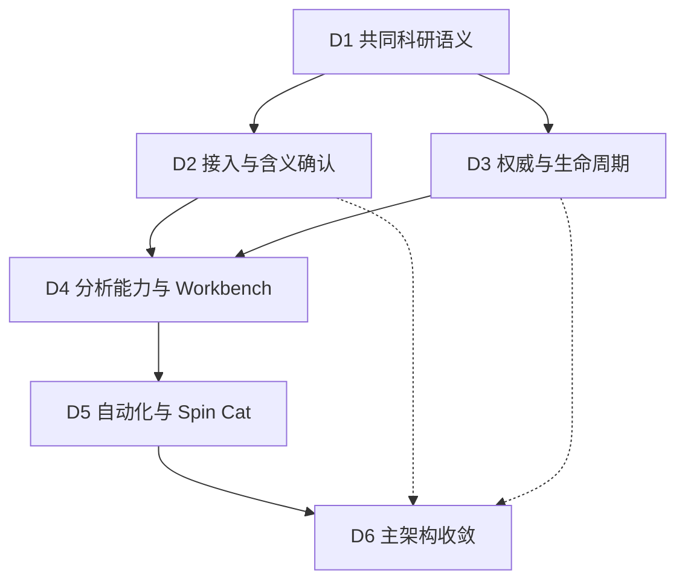

日期：2026年11月7日。状态：总体架构提案 v2；共同原则已经明确，专题决策与实施合同尚待后续讨论。

SpinLab 应成为以 Sample 为中心、让科研数据可以被理解和复用的研究系统。Inbox、Workbench 和 Library 共用科研对象、物理含义、来源和裁决规则；统一器整理数据含义；共享分析能力产生科研结果；独立自动化组织常规工作；Spin Cat 在授权与验证制度内提出改进。

V2 将“统一数据”进一步明确为“统一科研语义”，并把可靠的学习依据纳入数据与工作流设计。当前不枚举完整 entry，也不决定存储格式、数据库、具体算法或训练方式。

[V1 总体方案](https://chatgpt.com/space/page_731d657be97c81918591d3c17df27dcf) 保留为历史版本。V2 延续独立自动化、共享分析能力、前台真实管理、人工裁决优先、信息洁癖、学习与正式运行隔离和 Provider 独立性。

配套的 [专题讨论启动包 v2](https://chatgpt.com/space/page_bc521bc01a348191b13fdc67e5aac171) 包含 D1 至 D6 的完整 prompt，可分别用于新对话和最终回传。

# 一 本轮新增的产品原则

## 同一科研含义跨入口保持一致

同一物理量无论来自手工录入、仪器文件、Workbench 或自动分析，都应使用一致的科研含义、单位与归属规则。界面区域只改变查看和操作方式，不重新定义“电阻”“厚度”“测量条件”代表什么。

同一事实在多个界面出现时，引用同一权威表达。派生结果、不可变恢复快照和缓存可以存在，但不能悄悄形成可以分别修改的多份当前事实。

## 定量信息能够参与查询与判断

用户记录电阻或尺寸后，系统应知道这是什么量、属于哪个对象、采用什么单位、在什么背景下成立、来自哪里。这样才能筛选、比较、换算、分析与汇总。

例如，“电阻为 500 Ω”可能是一项有测量条件的观测，也可能是从曲线提取的结果，或用户在特定用途下选定的参考值。不同 Device、温度或测量方法所得的数值可能都成立，不能仅因同名就互相覆盖。

这些是信息应具备的含义，不是现在规定所有记录必须填写的字段。具体 entry、必填项和交互方式由专题讨论决定；前台仍可保持简洁。

## 统一不抹平结构和语境

标量、曲线、矩阵、图像、照片和文字分别保留合适的形态。已经明确且需要复用的科研含义应结构化；实验观察、假设和解释可以继续用文字表达，并与相关对象及证据关联。

文件名、列名、路径、样品显示名称和内部身份承担不同职责。身份应在合理的名称或位置变化后仍可追溯；具体标识方案及迁移方式不在总纲中预选。

## 观测 结果 采用与规则分别表达

一次观测、经过方法得到的结果、用户选定的当前有效值、适用于未来的规则，具有不同含义。

产生新结果不自动等于推翻用户已经采用的结果。“当前采用”需要明确对象、条件和用途范围；不能把某一条件下的人工选择推广为所有条件下的唯一正确值。

纠正旧记录与记录新的实验事实也需要区分。新温度下再次测量电阻，并不是对原温度观测的修正。两个值相同但来源或方法不同，也不必然属于重复成果。

## 允许信息逐步明确

数据可以先进入，再补充归属、单位、实验背景或通道含义。暂未归属 Sample 与暂不满足某项分析条件，是不同状态。

未知不能被转换成零值、猜测的单位或未经证实的物理角色。哪些条件是某项分析的必要前提，由能力契约说明；某个解释器的限制不能升级为所有数据的接收限制。

# 二 为 AI 学习保留什么

可学习性有两个层次。首先，系统应能读懂数据代表什么。其次，在重要科研活动中，系统应能关联研究背景、使用的方法、产生的结果，以及用户明确作出的判断。仅把文字改成数字与单位，不能自动让 AI 理解科研逻辑。

| 信息类别 | 应支持的理解 | 需要守住的边界 |
| - | - | - |
| 科研对象与观测 | 研究的是谁，观察到什么，哪些条件可比较 | 同名量不自动属于同一事实 |
| 解释与来源 | 含义来自仪器、规则、推断还是人工确认 | 保留未知及证据强弱，不把建议写成已知事实 |
| 分析活动 | 使用哪些输入、方法与有效配置，得到什么结果 | 计算结果与显示样式分别表达 |
| 用户判断 | 哪个结果被采用、纠正或否决，适用于什么范围 | 未提供理由时不推测动机，也不强迫每次操作写理由 |
| 可复用经验 | 哪些经过验证的解释或方法可以在什么条件下复用 | 局部判断不自动升级为全局规则 |

显式反馈比隐式行为更明确。反复查看、未打开或删除一张图，只能提供有限线索；删除重复成果不等于判定其物理信号无效，保存某结果也不等于证明方法普遍正确。

正式运行的来源记录、用户反馈、候选经验和未来训练样本应保持可区分。无需为了将来可能训练模型而记录所有点击、无限保留中间结果，或提前建设完整训练平台。

当前需要的是可解释、可纠正、可追溯并能检验规则变化的数据。以后使用检索、规则归纳、统计方法还是模型训练，取决于真实任务与证据。规则、授权、经验及验证依据属于 SpinLab，不仅存在于聊天或某个 Provider 中。

# 三 如何采用审计结果

[上传的架构审计](https://chatgpt.com/library?file_id=libfile_8ca73140609c8191906f8c18f9adeaa1\&account_id=personal) 基于提交 `86cd5c6ea707bf882fc415a4e8f4d1f1af2425af`，只进行了静态检查，没有构建、运行应用或执行测试。本轮对影响路线的部分读写链进行了定点源码复核，仍未作运行验证。

## 可以用于修订路线的发现

| 发现 | 对 V2 的影响 |
| - | - |
| 已有共享读取结构，但通道角色和实验含义仍部分由分析流程解释；现有前台规则不覆盖全部列含义 | 先讨论共同语义，再设计可管理的解释规则；保留合理读取边界 |
| AFM 处理内核可独立调用，完整分析仍涉及工作台配置和显示状态 | AFM 适合验证共享能力与独立执行，但不能独自证明表格数据统一化成立 |
| 标准数据、数值成果、图表与恢复包具有不同生命周期 | 标准数据和数值成果应有独立含义；保存图像不代表完整保存科研结果 |
| 指标追加会更新同一身份的最新指针，Library 展示读取该指针 | 在允许自动发布正式采用值前，明确“产生结果”和“选择当前采用结果”的分工 |
| 身份、外部来源、文件持久化和归档对象存在多种表达 | 明确每类对象的身份与权威，再决定兼容和迁移路径 |

指标读写关系已经静态核实：新记录保留在历史中，同时更新当前展示所用的指针。这说明需要裁决契约，不表示本轮已经运行并观察到自动化覆盖用户值。[追加与最新指针](https://github.com/Jiaze-Li/SpinLab/blob/86cd5c6ea707bf882fc415a4e8f4d1f1af2425af/Sources/SpinLabApp/Workbench/Modules/PlotSystem/Contracts/WorkbenchResultContracts.swift)；[Library 展示读取](https://github.com/Jiaze-Li/SpinLab/blob/86cd5c6ea707bf882fc415a4e8f4d1f1af2425af/Sources/SpinLabApp/Features/Library/LibraryMeasurementDataPresenter.swift)。

## 需要纠正或限定的审计结论

**旧 Domain 并非仅存于内存。** `ArchivedRecord` 存在实际的 JSON 读写和 Repository 加载、保存路径，并可包含 Device。这不等于现有产品已经具有完整独立 Device 管理；但不能依据“它不持久化”的假设忽略或删除这一体系。需要厘清它与 Library 文件对象的职责及映射。[实际持久化](https://github.com/Jiaze-Li/SpinLab/blob/86cd5c6ea707bf882fc415a4e8f4d1f1af2425af/Sources/SpinLabApp/Persistence/Persistence.swift)；[Repository 读写](https://github.com/Jiaze-Li/SpinLab/blob/86cd5c6ea707bf882fc415a4e8f4d1f1af2425af/Sources/SpinLabApp/Repositories/DomainRepositories.swift)；[归档对象结构](https://github.com/Jiaze-Li/SpinLab/blob/86cd5c6ea707bf882fc415a4e8f4d1f1af2425af/Sources/SpinLabApp/Domain/Models.swift)。

**Registry 是主要创建来源，不能直接称为全部 Sample 内容的唯一权威。** 本地 Sample 编辑先写 Library，再尝试同步 XLSX；缺少 Registry 或同步失败可以是非致命结果。本地已有 Sample 文件创建和更新能力，但完整脱离 Registry 的原生用户工作流仍需设计。[Sample 编辑与同步](https://github.com/Jiaze-Li/SpinLab/blob/86cd5c6ea707bf882fc415a4e8f4d1f1af2425af/Sources/SpinLabApp/UseCases/SaveLibrarySampleEditsUseCase.swift)；[本地 Sample 写入](https://github.com/Jiaze-Li/SpinLab/blob/86cd5c6ea707bf882fc415a4e8f4d1f1af2425af/Sources/SpinLabApp/Library/LibraryStore%2BDrawers.swift)。

**未发现正式自动化体系，不等于已证明所有位置都没有隐式计算。** 继续保留自动运行来源可识别、可管理的要求，后续只在相关模块补查实际触发链，不重复开展无边界的全仓审计。

**稳定身份不等于现在必须选定 machineUID。** 不同数据形状不等于必须采用不同文件格式；可恢复性不等于所有新对象必须依靠目录扫描；恢复包中的不可变快照不天然构成第二个权威源。这些属于后续方案比较，不由静态审计直接确定。

**现有原子写入保护不等于整个 Library 已有统一事务。** 现有路径既有批量提交，也有单文件原子写入；重建索引也会继承部分旧索引信息。需要明确实际保护和重建范围，再设计新对象的保存与恢复契约。

人工明确裁决优先、SpinLab 可以独立创建 Sample、录入不强制回写 XLSX 等产品方向已经确认，不重复将它们列为待用户选择的问题。

# 四 延续并完善总体架构

| 职责 | 负责什么 | 对其他部分的承诺 |
| - | - | - |
| 共同科研语义 | 明确对象、物理量、条件、实验角色、来源和判断的含义 | 跨 Inbox、Workbench、Sample 使用一致语言；这是共享约定，不预设一个庞大新模块 |
| 科研数据核心 | 身份、关系、正式记录、采用关系、修订、来源和生命周期 | 不因入口或调用者不同而绕过人工优先与数据治理 |
| Inbox 与统一器 | 接收来源数据、处理归属与解释、形成标准数据 | 交付可理解的数据及明确的未决信息；不隐含物理分析或后续自动调度 |
| 共享分析能力 | 依据明确输入与配置进行科研计算，输出数据、数值或图形所需内容 | 脱离对应 Workbench 页面仍有明确行为，不依赖上次控件状态 |
| Workbench | 人工探索、选择、调参、比较和制图 | 使用共享能力，显示状态不暗中改变科研数值 |
| 独立自动化 | 管理触发、适用范围、步骤依赖、运行及正式提交请求 | 前台能新建、修改和停用真实流程；执行使用生效版本 |
| Library | 围绕 Sample 查询、查看、整理和维护信息 | 展示当前有意义的内容，必要时可追溯，不另建一套科研事实 |
| Spin Cat | 提出解释、能力与流程变化，形成候选经验并验证 | 使用同一管理体系，遵守授权，不能保有隐形生产流程 |

统一器、手工录入与分析能力是不同的信息产生入口。它们应共同遵守语义和数据核心的规则，而不是把所有信息都塞进某一种仪器文件。

分析能力产生结果；用户操作或自动化根据授权决定是否正式保存或采用。候选试运行的输出处于候选范围，不得自行新增、修改或发布正式科研记录与成果，也不得改变采用关系。将候选成果转为正式成果，需要通过统一的确认、授权与提交规则。

正式保存与当前采用在语义上分开，不代表每次录入都需要两次确认。一次清楚的用户操作或已授权规则，可以同时表达相应决定。

自动化与 Spin Cat 共享权威流程对象及版本体系。前台修改形成候选修订，执行器使用已生效版本。用户亲自编辑并应用即表达决定；已授权的常规运行不反复请求确认。旧提案遇到已变化的基线时重新核对，不能覆盖后来的人为决定。

V1 中以下运行约束继续有效：

- 每次运行明确输入范围，以及所采用的数据解释、方法、能力和有效配置版本；中途编辑不静默改变正在运行的工作。

- 保存衍生成果不默认等于导入新测量，也不默认再次触发生成它的流程。

- 用户清理成果不成为无声再生的理由；重复运行遵守统一的成果治理。

- 兼容旧路径时，不能保留绕过前台定义的自动启动入口。

# 五 需要支持的完整科研工作流

## 人工信息进入系统

用户创建或选定 Sample 或 Device，记录尺寸、电阻、照片或观察。已明确的定量含义进入共享数据体系，文字与图片关联到相应对象和背景。条件不完整时保留未知，按用途补充，不要求用户先制作仪器文件或填写整套表格。

## 文件进入系统

Inbox 接收文件并保留来源。统一器区分结构读取和实验含义解释：已知规则可以自动使用；不明确通道由用户补充，或由 Spin Cat 提议。一次确认的适用范围明确后，才形成可复用规则。标准数据保存后可供多个分析使用。

## 人工或自动分析

分析明确消费哪一份数据、哪种解释、哪些条件与配置。Workbench 支持探索，自动化执行已定义的流程；两者复用同一计算能力。输出可以是数值、曲线、矩阵、图、报告或关联证据，不以“有没有保存 PNG”判断科研结果是否存在。

## 纠正 采用与重新分析

用户纠正一项观测、采用另一种结果或修改解释规则时，系统明确变更的是哪类信息及其范围。相关衍生成果可以被标为需要检查或重算，原成果不会静默冒充基于新事实。仅改变样式或无关备注不自动使所有分析失效。

## 自动化扩展与经验积累

用户提出“导入 RHEED 后分析”。Spin Cat 区分已有能力加入流程与缺少新能力，提出可检查的变化及验证依据。确认后，变化在同一自动化工作台正式生效。日常运行无需猫始终参与。重要修正与选择作为有语境的证据积累，是否升级为通用规则另行验证。

AFM、RHEED、AHE 可以在同一研究流程中组合，但各能力只消费适合自己的数据。报告明确汇总范围与必要依赖，未完成或不适用不能被当作完整成功。

# 六 五个专题讨论与一次主架构收敛

以下六步是设计讨论顺序，不是六项立即执行的编码任务。每个专题可以逐轮细化，具体 entry、方法、界面及实现选择在对应对话中讨论。主架构负责它们之间的一致性。

| 步骤 | 专题 | 主要讨论问题 | 主要交付物 |
| - | - | - | - |
| D1 | 科研对象与共同语义 | 对象与事实如何区分；量、单位、条件、实验角色如何表达；同一信息如何跨界面延续；学习所需的判断背景是什么 | 概念与关系说明、同一与不同的判定规则、少量代表案例、上下游需要遵守的语义约定 |
| D2 | 数据接入与含义确认 | 手工和文件入口如何共用语义；格式读取与实验解释的边界；未知、人工确认、规则复用和重解释 | 接入工作流、统一器输入输出承诺、解释规则适用范围、来源及未决状态原则 |
| D3 | 科研事实与成果生命周期 | 身份与来源权威；原生 Sample 与外部同步；观测、分析结果、当前采用值、修订、清理和恢复 | 权威与裁决规则、读写职责、生命周期、旧模型关系与迁移约束、学习证据保留原则 |
| D4 | 共享分析能力与 Workbench | 能力如何脱离页面存在；有效输入与配置；结果与显示分离；计算、试运行、正式保存如何衔接 | 能力契约、Workbench 边界、分析活动与结果约定、AFM 和表格分析的对照验证场景 |
| D5 | 前台自动化与 Spin Cat 协作 | 真实前台控制、触发与依赖、流程版本、异常恢复、建议确认、学习与正式运行隔离 | 用户工作流、自动化与提案生命周期、授权边界、经验形成与复用原则 |
| D6 | 回到主架构统一收敛 | 合并前五步的共同约定，处理冲突，判断最小验证路径和实施顺序 | 当前架构基线、共同契约索引、关键用户工作流、实施任务分界及验证要求 |

D1 先形成足以解释代表案例的初版，不追求定义整个科研世界。D2 与 D3 可以并行，相互发现的边界问题由主架构协调。D4、D5 可以提前收集案例和讨论选项，定稿时使用上游已采纳的约定。

AI 学习的数据需求从 D1 开始贯穿各专题：D1 明确含义，D2 保留解释来源，D3 区分观测与裁决，D4 关联方法和结果，D5 管理经验升级。当前无需另外启动一个训练平台项目。

# 七 每个专题怎样讨论和交付

每个新对话应收到本总纲、审计及其更正摘要，以及已经完成的上游决策稿。未提供的背景不能假装已知；尚未采纳的选择可以作为讨论假设，但不能写成全局决定。

讨论先从具体科研场景出发，提出少量真正影响产品行为或边界的抉择，给出建议和理由。必要时逐轮询问产品问题，不一次要求用户回答整套技术问卷，也不把普通内部实现选择交给用户审批。

每个专题最终交付一份可独立阅读的决策稿，包含：

1. 负责的问题与边界。

2. 已确认要求、源码或审计事实、仍未验证的假设。

3. 重要选项、代价、推荐及实际确认情况。

4. 依赖上游什么、对下游保证什么、哪些决定不能由本专题代做。

5. 代表场景与反例走查，包括相关的未知、纠正、重算或失败情况。

6. 未决问题及其是否阻塞其他专题。

7. 需要返回主架构处理的跨专题变化。

具体 entry 及字段目录可在对应专题后续继续研究；专题首份交付必须先明确它们为什么需要、属于谁、怎样被复用。最终用户问题未决时，提交讨论稿，不将建议冒充已确认决策。

用户把决策稿带回主架构后，主架构检查跨专题矛盾并更新一个当前基线。后续 channel 使用明确的已采纳版本，不依赖其他聊天的隐含记忆。普通范围内选择无需反复审批；改变共同语义、身份、权威或跨模块职责时才回到总纲协调。

V1 保留历史；当前总纲只维护当前共同约定；每个专题维护自己的细化决策。实施任务再引用这些内容，避免同一规则在多份文档中独立演进。已有技术债继续由仓库既定 TASK_BOARD 管理。

# 八 对未来实施路线的宏观约束

在专题收敛前，不把一份初步设计直接变成完整冻结的 Coding Agent 任务。可以先确定哪些性质必须被验证，而不预先决定全部代码改动。

## 需要两条互补验证路径

\*\*科研语义路径：\*\*手工尺寸或电阻信息，加上一份含歧义通道的表格测量。验证对象、单位、条件、解释来源、多分析复用，以及用户采用和纠正如何影响当前信息。

\*\*独立执行路径：\*\*以 AFM 等已有较清晰计算边界的能力，验证显式输入配置、人工与自动共用计算、无需打开对应 Workbench、新建和修改前台流程真实控制执行、成果按授权保存。

两条路径都通过相应验证后，才有依据声称核心架构支持统一科研数据和可管理自动化。单独跑通 AFM 不足以证明语义、裁决或原生录入正确；单独定义语义模型也不证明前台能够控制后台执行。

## 哪些决定应提前

在新增正式写入入口之前，身份、来源和裁决责任要明确。在允许自动结果改变正式采用值之前，人工优先与采用规则必须落实。只产生候选结果的试点可以有较窄范围，不必等待全部 Sample 功能重构完成。

这要求先明确契约，不等于先实施某一种 UID、数据库或全部文件迁移。复用现有读取器、算法和保存能力；对于旧 Domain、Library 文件模型、索引和恢复包，先识别各自职责与真实消费者，再选择兼容和收敛方式。

## 验证应覆盖哪些性质

- 同一事实跨入口保持同一含义和来源，独立新观测不会被误当作纠错。

- 同名量在条件或对象不同的情况下仍可区分，未知不被伪造为确定信息。

- 新解释规则能由前台管理并被下游复用。

- 新自动化能用已有能力在前台建立，修改与停用对实际执行生效。

- 人工与自动入口共享科学处理，方法和输入能够追溯。

- 新结果、正式保存与当前采用有明确区别，人工决定不被静默推翻。

- 纠正、重算、重复执行、删除及恢复遵守同一治理原则。

- 候选经验可以检验与撤销，隐式行为不被当作科研真值。

这些是后续选择验证方式的目标，目前不是已完成的运行验收。AI 学习效果也需要未来真实任务单独评估，不能由“数据已经结构化”直接推出。

# 九 留给各专题的具体选择
 
具体 entry、字段与必填规则，标识与别名方案，单位和实验角色词汇的完整范围，存储、文件格式及索引设计，能力安装机制，节点画布，RHEED 等科学方法，模型或训练技术，均由对应专题根据共同原则讨论。

读取实现、渲染线程要求、包体积、真实旧数据冲突、兼容路径消费者等未验证事项，在相关专题定点补证即可，不要求先重新开展一次完整审计。

下一步优先启动 D1。它的第一份成果应能一致解释“样品尺寸、带条件的电阻观测、未知 Bridge、AFM 通道、人工采用与新分析结果”这组案例，并给 D2、D3 提供足够明确的共同语言。
